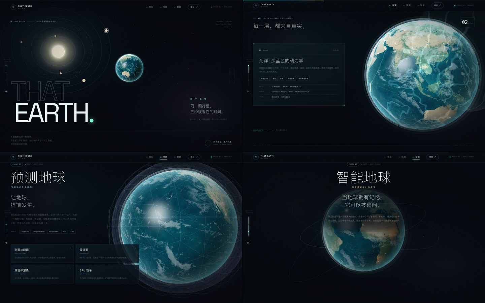
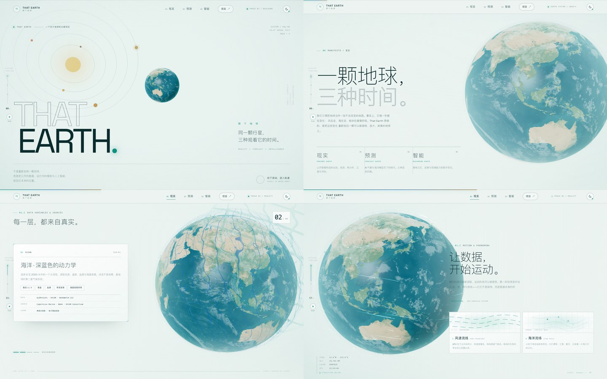
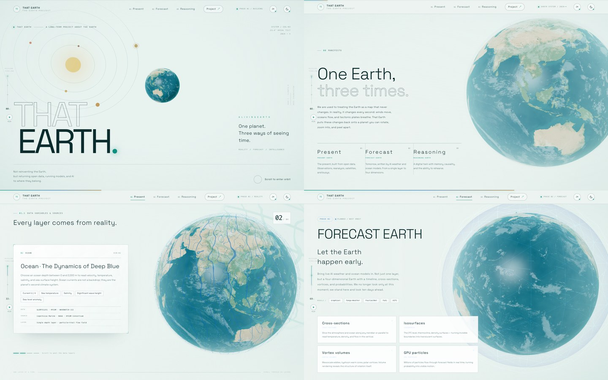

# THAT EARTH · 那个地球







一个以 Three.js 构建的视差滚动落地页，提供暗色 / 明亮双主题与中文 / English 双语。首次访问默认跟随系统配色与系统语言，也可在右上角手动切换。用一颗可被旋转、放大与逐层剥离的三维地球，串起 That Earth 项目的三个阶段：

1. **现实地球** — 公开数据源构成的此刻（正文重点展开）
2. **预测地球** — AI 气象 / 海洋模型驱动的未来
3. **智能地球** — 拥有记忆、推理与情景预演的数字孪生

线上域名：`https://that.earth/`

## 本地运行

需要 Node.js 22 与 pnpm 10（版本见 `.nvmrc` / `package.json`）。

```bash
pnpm install
pnpm dev
```

默认开发地址为 `http://127.0.0.1:5173/`，若端口被占用，Vite 会自动切换到下一个端口。

生产构建：

```bash
pnpm build
pnpm preview
```

构建产物位于 `dist/`。仓库已内置 Vercel 配置，可直接部署；也适用于 Netlify、Cloudflare Pages 或任意静态服务器。

## 部署到 Vercel

仓库根目录已包含 Vercel 所需配置：

| 文件 | 作用 |
| --- | --- |
| `vercel.json` | 指定 Vite 框架、安装 / 构建命令、输出目录、`www.that.earth` → `that.earth` 跳转、静态资源缓存与基础安全响应头 |
| `.vercelignore` | 排除本地截图、`node_modules` 与 `dist`，避免把构建产物和预览图上传到构建环境 |
| `.nvmrc` | 本地版本管理使用 Node.js 22；Vercel 通过 `engines.node` 固定为 22.x |
| `package.json` | `engines.node: 22.x`、`packageManager: pnpm@10.27.0`，保证 Vercel 使用一致的运行时与包管理器 |

### 通过 Git 导入（推荐）

1. 在 [Vercel New Project](https://vercel.com/new) 导入 `yaohengkai/that-earth`。
2. Framework Preset 选择 **Vite**；若表单未自动填充，使用：
   - Install Command：`pnpm install --frozen-lockfile`
   - Build Command：`pnpm build`
   - Output Directory：`dist`
3. 点击 Deploy。项目不需要环境变量。
4. 在 **Settings → Domains** 添加 `that.earth` 与 `www.that.earth`，将 `that.earth` 设为 **Primary Domain**，按 Vercel 提示修改 DNS。`vercel.json` 会把 `www` 永久跳转到 `that.earth`。

### 通过 CLI 部署

```bash
pnpm dlx vercel          # 预览部署
pnpm dlx vercel --prod   # 生产部署
```

首次执行会要求登录并关联 / 创建 Vercel 项目；生成的 `.vercel/` 已加入 `.gitignore`，不要提交。

> 页面内的 canonical、Open Graph、`robots.txt` 与 `sitemap.xml` 均指向 `https://that.earth/`。如果暂时使用 `*.vercel.app` 域名预览，这些绝对地址仍会指向正式域名；正式上线前请确认 `that.earth` 已绑定到 Vercel。

## 页面结构

- `index.html` — 全部语义化页面结构、三阶段文案、数据变量与数据源
- `src/style.css` — 视觉系统、暗色 / 明亮双主题、双语排版、HUD、响应式布局与逐段显影
- `src/i18n.js` — 中英文文案词典、静态文本替换、标题 / Meta / JSON-LD 更新与语言控制
- `src/scene/World.js` — Three.js 世界：地球、太阳系、数据壳层、轨道、粒子、相机编排与 `setTheme()`
- `src/scene/shaders.js` — 地表、云层、大气、数据层、等值面与星空的 GLSL（含明亮主题调色分支）
- `src/scene/Flow.js` — 风场 / 洋流粒子尾迹与闪电
- `src/ui.js` — 滚动状态、固定侧栏、HUD、数据卡片、分段文案与自动播放
- `src/counter.js` — 页脚访问统计（Vercount）：等待计数返回、千分位格式化与显隐
- `src/main.js` — 加载、主题 / 语言控制、启动与渲染循环

## 场景逻辑

- 相机由滚动进度驱动，地球在章节之间左右平移，并在首屏完成“远景太阳系 → 近景地球”的推进。
- 页面打开后自动播放：左侧进度条下方（移动端为左下角浮动胶囊）的按钮可暂停 / 继续，章节切换有停留时间；结束显示 `REPLAY`。手动滚动、触摸、键盘或点击导航会自动暂停。
- 右上角主题按钮在暗色 / 明亮之间切换；首次访问跟随 `prefers-color-scheme`，手动选择会写入 `localStorage`，系统配色变化时仅在“跟随系统”状态下自动更新。
- 右上角 `EN / ZH` 按钮切换语言；首次访问根据系统语言自动选择（`zh-*` → 中文，其他 → English）。手动选择写入 `localStorage`，系统语言变化时仅在“跟随系统”状态下自动更新。
- 第一阶段的数据章节使用 sticky 布局，滚动时依次激活四层数据壳（大气 / 海洋 / 地质 / 生物地球化学），上一层的壳体会从地球表面剥离、漂浮并消散。
- 效果章节启用风场流线、洋流粒子尾迹与闪电；第二阶段启用等值面与线框；第三阶段出现轨道环与智能体节点。
- 合成稳定性：为避免滚动时出现黑色方块/空帧，界面不使用 `backdrop-filter` / `mix-blend-mode` 等高风险合成层；WebGL 渲染器启用 `preserveDrawingBuffer`，并以 `translateZ(0)` 固定画布图层。渲染管线采用直接输出：已移除离屏 `EffectComposer` / `UnrealBloomPass`，改为 `renderer.render()` 直出，并在自定义 shader 中内联 tone mapping 与颜色空间转换。这样既保留了当前视觉，又规避了 Bloom 渲染目标在部分 GPU/浏览器组合上的黑块问题。

## 语言 / Language

- 右上角 `EN / ZH` 按钮切换中英文，默认跟随 `navigator.language`：中文系统显示中文，其余显示 English。
- 语言选择保存在 `localStorage` 的 `that-earth-lang` 中；手动切换后按钮右下角圆点消失，表示不再跟随系统。
- 英文文本由 `src/i18n.js` 在运行时替换全部静态节点，同时更新 `<html lang>`、`document.title`、description、Open Graph / Twitter meta 与 JSON-LD。
- 主题与语言相互独立：可以在明亮 English、暗色中文等任意组合之间切换。

## 主题系统

- 页面在 `<head>` 内先用一段内联脚本读取 `localStorage` 与系统配色，写入 `html[data-theme]`，避免首屏闪烁。
- 默认状态为 `data-theme-source="system"`；此时系统配色变化会实时同步。点击右上角按钮后变为 `manual`，选择被记住。
- CSS 使用 `html[data-theme="light"]` 覆盖整套变量与组件；Three.js 通过 `World.setTheme()` 同步更新清除色、星空 / 太阳系、地球光照与调色板、数据层混合模式、大气、等值面、轨道与闪电颜色。
- 主题按钮上的小圆点表示“跟随系统”；手动切换后圆点消失。

## 参考项目 / 先行复刻

落地页底部的四张卡片，是对以下项目的学习、复刻与再搭建，均已部署在 That Earth 子域名：

| 参考项目 | 我的线上版本 | 源码 |
| --- | --- | --- |
| [earth.nullschool.net](https://earth.nullschool.net/) | [earth-classic.that.earth](https://earth-classic.that.earth/) | [yaohengkai/earth-rea](https://github.com/yaohengkai/earth-rea) |
| Fluid Earth | [fluid-earth.that.earth](https://fluid-earth.that.earth/) | [yaohengkai/fluid-earth](https://github.com/yaohengkai/fluid-earth) |
| Earth Clock | [earth-clock.that.earth](https://earth-clock.that.earth/) | [yaohengkai/earth-clock](https://github.com/yaohengkai/earth-clock) |
| [Ventusky](https://www.ventusky.com/) | [ventusky.that.earth](https://ventusky.that.earth/) | [yaohengkai/ventusky-rea](https://github.com/yaohengkai/ventusky-rea) |

这几个子项目分别验证了实时风场、海洋流体、地球光照与天气场等不同方向，也是 That Earth 第一阶段的重要技术积累。

## 素材与致谢

- 地表影像：NASA Blue Marble（Visible Earth，公有领域）
- 云层影像：NASA Earth Observations (NEO)（公有领域）
- 3D 引擎：[Three.js](https://threejs.org/)
- 字体：Space Grotesk（SIL Open Font License）

## 上线前可调整

- 联系邮箱目前为占位地址 `hello@that.earth`（`index.html` 中 `mailto:` 链接）。
- 底部四张参考项目卡片与源码链接集中在 `index.html` 的 `.subdomains` / `.case-repos` 中；若子域名或仓库地址调整，在这里同步替换。
- `og.jpg` 为社交分享预览图，可按最终视觉替换。
- 域名 DNS 在 Vercel 项目的 **Settings → Domains** 中配置；将 `that.earth` 与 `www.that.earth` 指向 Vercel 后即可生效。
